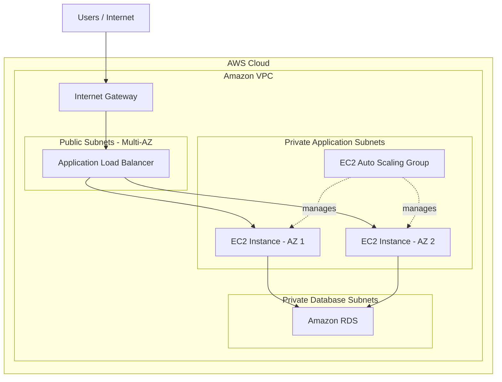

# AWS Three-Tier Web Application Architecture

## Project Overview

This project demonstrates the design of a scalable and secure
three-tier web application architecture using Amazon Web Services (AWS).

The architecture separates the application into three independent
layers: Web Tier, Application Tier, and Database Tier.

It uses Amazon VPC, EC2, Application Load Balancer, Auto Scaling,
Amazon RDS, IAM, Security Groups, and Route Tables.

## Real-World Problem

Applications hosted on a single server can face challenges such as:

- Server failure can make the entire application unavailable.
- Increasing user traffic can affect application performance.
- Exposing databases directly to the internet creates security risks.
- Managing application growth becomes difficult without scalability.

## Proposed Solution

This architecture addresses these challenges through a
three-tier design:

- **Web Tier:** Handles incoming user traffic through an
  Application Load Balancer.
- **Application Tier:** Runs application instances on EC2
  within private subnets, with Auto Scaling.
- **Database Tier:** Stores application data in Amazon RDS
  within private subnets.

Each tier is separated using network boundaries and
Security Group rules.

## Key AWS Services

- Amazon VPC
- Public and Private Subnets
- Internet Gateway
- Route Tables
- Application Load Balancer
- Amazon EC2
- Auto Scaling Group
- Amazon RDS
- IAM
- Security Groups

## Architecture Diagram

## Key Benefits

- Improved application scalability.
- Better network isolation.
- Reduced direct exposure of database resources.
- Improved availability through multiple application instances.
- Easier infrastructure management.

## Project Status

**Type:** AWS Cloud Architecture Portfolio Project

This repository documents a reference three-tier architecture
and its AWS configuration concepts.

Actual AWS infrastructure deployment and testing have not
been verified.

## Learning Outcomes

- Understanding AWS VPC networking.
- Designing public and private subnet architectures.
- Understanding load balancing and Auto Scaling.
- Understanding secure database connectivity.
- Learning how to design scalable cloud infrastructure.
